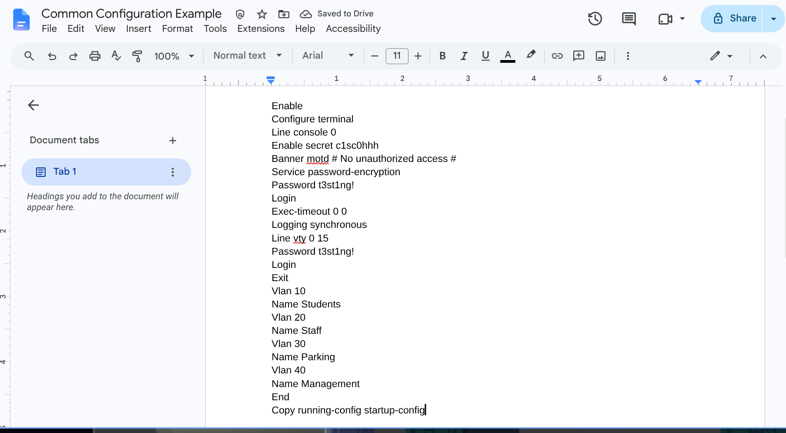
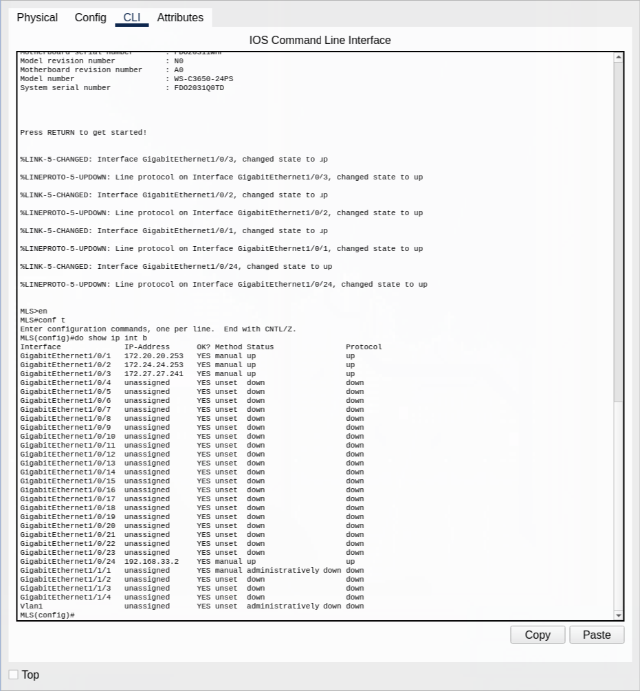
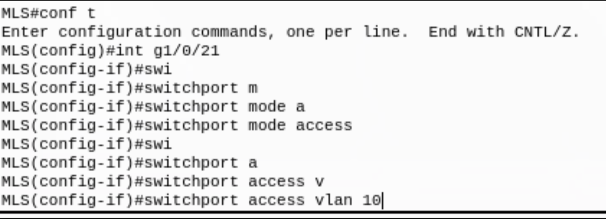

1. Have the privileged EXEC and console passwords somewhere written that you can easily copy and paste
1.1 Alternatively, inside your console configuration, use `exec-timeout 0 0` so that you never get timed out, 
    but you might want to restore it to its original setting after you're done configuring everything.
2. If you find that the syslog messages that pop are annoying (the messages that interrupt you mid way through typing),
   you can configure inside the console configuration `logging synchronous`.
3. For any sort of "common configuration", it is wise to open up some sort of note app and write all the commands.

Then, copy and paste these into the devices to save time and make sure you didn't mess up from human error.
4. Have Netacad modules open on a second/personal device and a list of commands if you have one
5. For long sets of configurations, you might want to use a note app (again) like for long ACLs or DHCP configuration
   as a way to see if you messed up later when you're double checking or something isn't working properly
6. SAVE THE CURRENT CONFIGURATION BEFORE YOU MOVE ON TO ANOTHER DEVICE
7. Save the Packet Tracer Often (maybe once every 30 minutes or after a major configuration)
8. Get used to using show commands to verify your configurations
8.1 If you want to use show commands while you're in some sort of configuration mode, add `do` at the front
Ex: `do show ip interfaces brief` 
9. Do the quiz first before the Packet Tracer (ideally within 20 minutes)
10. Get used to reading CIDR notation for subnet masks. This is the / notation (like /24)
11. Try to configure devices that are similar to each other as a group (like configuring one switch then another right after)
12. Use `ping` to verify connectivity between devices and `traceroute` if you need to confirm data is traveling a certain path
13. Use tab or the first few characters for commands to save on time

See here I only typed the first few characters in a command then pressed tab.
Instead of typing 'switchport' I just typed 'swi', then 'a' for 'access', and 'v' for 'vlan' etc.
14. If you ever get confused about a concept or see something new, write it down to study later.
